# Garmin CN ↔ Global 全量无损迁移工具 (`garmin-cn-global-migrator`)

[](https://www.python.org/)
[](LICENSE)

**`garmin-cn-global-migrator`** 是一款专为佳明（Garmin Connect）用户打造的 **中国区 (`connect.garmin.cn`) ↔ 国际区 (`connect.garmin.com`) 全量高保真数据搬迁与同步工具**。

由于佳明中国区与国际区服务器完全物理隔离，官方不支持跨区转号；而市面上现有的同步脚本大多只做到了“把 `.fit` 运动轨迹传过去”，导致**自定义活动名称变成英文默认名、运动备注丢失、跑鞋累计里程清零、体重体脂与全天健康数据无法迁移**。本项目在深度整合开源社区主流方案的基础上，补齐了上述所有拼图。

---

## 🌟 核心特性与对比

| 迁移维度 | 传统跨区脚本 (`DailySync` 等) | 本项目 (`garmin-cn-global-migrator`) |
| :--- | :--- | :--- |
| **登录与反爬 (Anti-WAF)** | 旧版 OAuth1 极易触发 Cloudflare `403 / 429` | **5 策略级联登录 (`curl_cffi` 浏览器 TLS 指纹伪装)** + 原生 DI OAuth2 令牌持久化 + 终端交互式 MFA 验证码支持 |
| **运动轨迹导出** | 仅支持下载原始 `.fit`，遇到第三方导入或无轨迹记录即报错跳过 | **4 级自动回退**：`Original .fit` $\rightarrow$ `.tcx` $\rightarrow$ `.gpx` $\rightarrow$ `JSON 手动活动重建`，确保 100% 活动不遗漏 |
| **活动元数据与笔记** | 上传后标题被重置为 `"Running"`，备注、星标、力量训练组数全部丢失 | **自动回写元数据**：上传后自动还原**自定义中文标题**、**运动备注 (`description`)**、**收藏星标**、**比赛类型**及**力量训练每组动作/重量/次数 (`exerciseSets`)** |
| **全天候健康监测 (Wellness)** | 不支持或落盘大量零碎文件 | 按日拉取 `/download-service/files/wellness/YYYY-MM-DD`，**全内存流式解压上传**，还原**步数、睡眠阶段、全天心率、压力、身体电量、HRV、呼吸与血氧** |
| **体重与 12 项身体成分** | 不支持 | 自动将克转换为千克，通过**二进制 FIT 编码器 (`FitEncoderWeight`)** 将体重、BMI、体脂率、水分率、骨骼肌、骨量、内脏脂肪、代谢年龄等 12 项指标打包为标准 `.fit` 上传 |
| **血压记录** | 不支持 | 自动按年分片拉取历史收缩压、舒张压、脉搏及测量备注并写入目标端 |
| **跑鞋装备与里程恢复** | 不支持，换区后跑鞋里程归零 | 自动在目标端重建活跃/退役装备，并**根据源活动与目标活动 ID 映射表自动重新绑定每一条运动**，完整恢复跑鞋累计里程 |
| **自定义训练课表** | 不支持 | 自动剥离区域专属主键，跨区重建间歇跑、力量训练等自定义训练计划 (`Workouts`) |
| **官方离线导出包导入** | 不支持 | 支持直接读取佳明官网导出的全量备份包（`DI_CONNECT` 目录或多层嵌套 `.zip`），免源端拉取直接批量上传 |
| **Intervals.icu 全量直连同步** | 不支持（佳明官方不向第三方推送外部导入的历史数据） | 内置 `migrate-intervals` 模块，**直接将佳明国区/国际区的历史 `.fit` 运动与每日健康指标（HRV、静息心率、睡眠分数/时长、体重体脂、血氧、呼吸、血压、$\text{VO}_2\text{max}$）批量推入 Intervals.icu** |
| **断点续传机制** | 中断后需重头扫描比对 | 内置 **SQLite 本地状态账本 (`migration_ledger.db`)**，精确记录每一条活动、每一天健康包、每一次称重，随时按 `Ctrl+C` 中断并秒级续传 |

---

## 🏗️ 工作原理架构

```mermaid
flowchart LR
    subgraph Source["源端：佳明中国区 (garmin.cn)"]
        S_ACT["运动记录 (.fit / .tcx / .gpx / JSON)"]
        S_META["自定义标题 / 备注 / 星标 / 力量组数"]
        S_WELL["每日健康监测包 (步数/睡眠/心率/身体电量/HRV)"]
        S_BODY["体重 12 项体脂成分 & 血压记录"]
        S_GEAR["跑鞋/单车装备 & 自定义训练课表"]
    end

    subgraph Engine["garmin-cn-global-migrator 核心引擎"]
        AUTH["5 策略 Anti-WAF 鉴权 + Token 缓存"]
        DEDUP["双端时间戳预查重 + SQLite 断点账本"]
        FIT_ENC["内存 ZIP 流式解压 & FIT 二进制编码器"]
    end

    subgraph Target["目标端：佳明国际区 (garmin.com)"]
        T_UPLOAD["POST /upload-service/upload"]
        T_META["PUT /activity-service/activity/{id}"]
        T_GEAR["重建装备并按 ID 映射表重绑活动里程"]
    end

    Source --> Engine --> Target
```



---

## 🚀 快速上手

### 1. 安装依赖

要求 **Python 3.10+**。克隆本仓库并安装依赖：

```bash
git clone https://github.com/Justmao1/garmin-cn-global-migrator.git
cd garmin-cn-global-migrator

python3 -m venv .venv
source .venv/bin/activate
pip install -r requirements.txt
```

### 2. 迁移前必读准备（避坑关键）

在向国际区（或目标区）写入数据前，请确保目标账号已完成以下两项设置：

1. **开启隐私与设备上传权限（防止报 `HTTP 412` 错误）**：
   * 浏览器登录 [Garmin Connect 国际区隐私设置](https://connect.garmin.com/modern/settings/privacySettings)。
   * 确保 **「存储和处理 (Storage and Processing)」** 设为 **同意**，且 **「设备上传 (Device Upload)」** 设为 **启用**。
2. **绑定过一次佳明手表（防止健康数据报 `HTTP 419` 错误）**：
   * 运动轨迹、体重体脂、跑鞋装备、训练课表**不需要**目标账号绑表即可直接迁入。
   * 但如果你需要迁入 **每日健康监测数据（步数、睡眠、身体电量、HRV、压力）**，佳明服务器要求目标账号名下必须存在已激活的硬件设备。请先在手机 Garmin Connect App 登录国际区账号，将手表配对同步一次后再运行健康数据迁移。

### 3. 配置账号

复制环境变量模板并填入你的佳明中国区与国际区账号密码：

```bash
cp .env.example .env
```

编辑 `.env`：

```ini
# 佳明中国区账号 (connect.garmin.cn)
GARMIN_CN_USERNAME=your_cn_email@example.com
GARMIN_CN_PASSWORD=your_cn_password

# 佳明国际区账号 (connect.garmin.com)
GARMIN_GLOBAL_USERNAME=your_global_email@example.com
GARMIN_GLOBAL_PASSWORD=your_global_password

# 迁移方向：cn_to_global (默认，中国区->国际区) 或 global_to_cn (国际区->中国区)
MIGRATE_DIRECTION=cn_to_global

# 每次上传之间的间隔秒数（建议 1.5 ~ 3.0 秒，防止请求过快触发限流）
UPLOAD_DELAY_SECONDS=1.5
```

---

## 💻 命令使用指南

### 第一步：账号登录验证与就绪自检 (`check`)

首次运行请先执行 `check`。若账号开启了两步验证（MFA），终端会提示输入邮箱/短信验证码；登录成功后 Token 将安全保存在 `./data/tokens/`（权限 `0600`），后续执行任何迁移命令均无需再次登录：

```bash
python3 migrate.py check
```

### 第二步：执行数据迁移

#### 方案 A：一键全量搬迁 (`migrate-all`)
自动按顺序执行：**运动活动+元数据 $\rightarrow$ 跑鞋装备+里程重绑 $\rightarrow$ 自定义训练计划 $\rightarrow$ 体重 12 项体脂+血压 $\rightarrow$ 每日全天候健康监测数据**。

```bash
# 1. 预览模式（仅拉取统计并打印将要迁移的内容，不实际写入目标区）
python3 migrate.py migrate-all --dry-run

# 2. 正式执行全量搬迁
python3 migrate.py migrate-all
```

#### 方案 B：按模块分步迁移（推荐大跨度历史账号使用）

1. **迁移运动记录（含自定义标题、备注、收藏、力量组数还原）**：
   ```bash
   # 全量迁移所有历史运动（默认按时间从旧到新正序上传）
   python3 migrate.py migrate-activities

   # 先拿最近 5 条运动测试效果
   python3 migrate.py migrate-activities --limit 5 --newest-first

   # 迁移指定日期区间的运动
   python3 migrate.py migrate-activities --start-date 2025-01-01 --end-date 2026-10-29
   ```

2. **迁移跑鞋/单车装备并恢复装备累计里程**：
   > 💡 建议在 `migrate-activities` 完成后执行，脚本会自动读取活动映射表将目标端运动挂接到对应跑鞋下。
   ```bash
   python3 migrate.py migrate-gear
   ```

3. **迁移自定义训练计划 (`Workouts`)**：
   ```bash
   python3 migrate.py migrate-workouts
   ```

4. **迁移体重、12 项体脂成分与血压记录**：
   ```bash
   python3 migrate.py migrate-body
   ```

5. **迁移每日健康监测数据（步数、睡眠、心率、压力、身体电量、HRV）**：
   ```bash
   # 迁移最近 30 天的日常健康数据
   python3 migrate.py migrate-wellness --days 30

   # 迁移指定日期区间的日常健康数据
   python3 migrate.py migrate-wellness --start-date 2025-01-01 --end-date 2026-10-29
   ```

#### 方案 C：从佳明官方全量离线导出包导入 (`import-offline`)
如果你在 [佳明中国区账户数据管理页](https://www.garmin.cn/zh-CN/account/datamanagement/) 申请了官方全量数据导出（收到邮件下载的 `.zip` 备份包），可以直接将该 `.zip` 文件或解压后的文件夹传给脚本批量导入国际区，无需逐条请求国区下载接口：

```bash
python3 migrate.py import-offline /path/to/Garmin_Export.zip
```

#### 方案 D：同步历史运动与全量健康数据至 Intervals.icu (`migrate-intervals`)
由于佳明官方对第三方平台（Strava / Intervals.icu）仅推送手表**新产生**的运动，不会主动推送外部手动导入的历史数据，且佳明国际区不开放历史 HRV 与睡眠分数重算写入，你可以使用 `migrate-intervals` 直接将佳明国区（或国际区）的数据无损推入 [Intervals.icu](https://intervals.icu/)：

1. 登录 [Intervals.icu Settings](https://intervals.icu/settings)，滑到底部 **Developer Settings**，复制你的 **Athlete ID**（或保持默认 `0` 自动识别）并点击生成 **API Key**。
2. 在 `.env` 中填入：
   ```ini
   INTERVALS_ATHLETE_ID=0
   INTERVALS_API_KEY=你的_Intervals_API_Key
   ```
3. 执行同步命令：
   ```bash
   # 一键将佳明国区的历史运动 (.fit) + 每日健康数据 (HRV/静息心率/睡眠分数/体重体脂/血氧/血压) 同步至 Intervals.icu
   python3 migrate.py migrate-intervals

   # 仅同步最近 30 天的健康数据（HRV、睡眠分数、静息心率、体重等）
   python3 migrate.py migrate-intervals --wellness-only --days 30

   # 使用快速区间批量模式同步全年健康数据（秒级完成全年 RHR/HRV/睡眠分数/步数/体重/血压聚合写入）
   python3 migrate.py migrate-intervals --wellness-only --start-date 2025-01-01 --fast-wellness
   ```

### 查看本地断点账本统计 (`status`)

随时查看各模块已成功、跳过或失败的记录数：

```bash
python3 migrate.py status
```

---

## ❓ 常见状态码与故障排查

| 状态码 / 现象 | 原因说明 | 解决办法 |
| :--- | :--- | :--- |
| **`HTTP 409 (Conflict)`** | 目标账号已存在相同时间戳的运动或健康文件 | 正常现象，脚本会自动识别为 `duplicate` 并记入本地账本跳过。 |
| **`HTTP 412 (Precondition Failed)`** | 目标账号未开启隐私存储与设备上传开关 | 登录目标区网页端「账户设置 $\rightarrow$ 隐私设置」，开启「存储和处理」与「设备上传」。 |
| **`HTTP 419`** | 目标账号未绑定过任何支持健康监测的佳明设备 | 手机 App 登录目标区账号，将佳明手表配对同步一次后再运行 `migrate-wellness`。 |
| **`HTTP 429 (Too Many Requests)`** | 请求过快触发 Cloudflare 速率限制 | 脚本内置指数退避自动重试；你也可以在 `.env` 中将 `UPLOAD_DELAY_SECONDS` 调大至 `2.5` 或 `3.0`。 |

---

## 🙏 致谢与参考项目

本项目在设计与实现过程中参考并汲取了以下优秀开源项目的思路与底层协议封装，特此致谢：
* [cyberjunky/python-garminconnect](https://github.com/cyberjunky/python-garminconnect) — Python Garmin Connect API 封装与 FIT 编码器实现
* [matin/garth](https://github.com/matin/garth) — 佳明 SSO 与 OAuth 令牌交换机制研究
* [gooin/dailysync-rev](https://github.com/gooin/dailysync-rev) — 跨区活动查重与每日 Wellness `.fit` 同步思路
* [Andrewshihs/garmin-sync](https://github.com/Andrewshihs/garmin-sync) — 多格式导出回退与同步账本设计

## 📄 开源协议

本项目基于 [MIT License](LICENSE) 开源。请注意妥善保管个人的 `.env` 与 `data/tokens/` 目录，切勿将包含个人凭据的文件提交至公开仓库。
